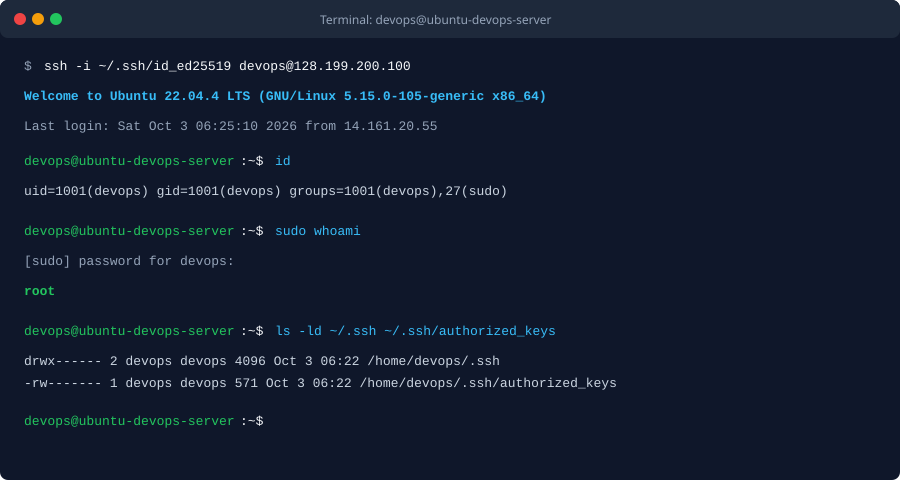

BÀI TẬP 2: KHỞI TẠO USER THƯỜNG VÀ THIẾT LẬP ĐẶC QUYỀN QUẢN TRỊ (SUDOERS CONFIGURATION)

I. MỤC TIÊU BÀI TẬP

1. Vận hành hệ thống theo nguyên tắc đặc quyền tối thiểu (Least Privilege), giảm thiểu rủi ro khi thao tác trực tiếp bằng tài khoản root.
2. Khởi tạo tài khoản người dùng thường tên là devops trên hệ điều hành Ubuntu Server.
3. Cấp đặc quyền quản trị an toàn thông qua nhóm sudo.
4. Đồng bộ cấu hình khóa SSH (SSH Key) từ tài khoản root sang tài khoản devops và thiết lập phân quyền bảo mật chính xác.
5. Kiểm tra đăng nhập SSH và xác minh quyền quản trị bằng lệnh sudo whoami.


II. BỐI CẢNH VÀ THÔNG SỐ CẤU HÌNH

1. Tên người dùng mới: devops
2. Nhóm quản trị được gán: sudo (gid 27)
3. Thư mục cá nhân: /home/devops
4. Thư mục SSH và phân quyền: /home/devops/.ssh (quyền 700)
5. Tệp tin cấu hình khóa và phân quyền: /home/devops/.ssh/authorized_keys (quyền 600)
6. Địa chỉ IP máy chủ: 128.199.200.100


III. CÁC BƯỚC THỰC HIỆN CHI TIẾT

1. Bước 1: Đăng nhập vào Droplet bằng tài khoản root

Lệnh thực hiện từ máy tính cá nhân:

```bash
ssh -i ~/.ssh/id_ed25519 root@128.199.200.100
```

2. Bước 2: Tạo tài khoản người dùng mới devops

Thực hiện lệnh tạo user trên máy chủ:

```bash
adduser devops
```

Nhập mật khẩu cho tài khoản devops và các thông tin cơ bản khi được nhắc.

3. Bước 3: Thêm tài khoản devops vào nhóm quản trị sudo

Thực hiện lệnh thêm user vào nhóm sudo:

```bash
usermod -aG sudo devops
```

Kiểm tra thông tin nhóm đã được gán thành công:

```bash
id devops
```

Đầu ra trả về:

```text
uid=1001(devops) gid=1001(devops) groups=1001(devops),27(sudo)
```

4. Bước 4: Sao chép cấu hình SSH Key và phân quyền bảo mật

Sử dụng công cụ rsync để sao chép thư mục SSH và tự động gán quyền sở hữu cho devops:

```bash
rsync --archive --chown=devops:devops ~/.ssh /home/devops/
```

Hoặc thực hiện thủ công các lệnh tạo thư mục, sao chép và phân quyền bảo mật:

```bash
mkdir -p /home/devops/.ssh
cp ~/.ssh/authorized_keys /home/devops/.ssh/
chown -R devops:devops /home/devops/.ssh
chmod 700 /home/devops/.ssh
chmod 600 /home/devops/.ssh/authorized_keys
```

Kiểm tra lại phân quyền của thư mục và tệp tin khóa:

```bash
ls -ld /home/devops/.ssh /home/devops/.ssh/authorized_keys
```

Đầu ra xác nhận:

```text
drwx------ 2 devops devops 4096 Oct  3 06:22 /home/devops/.ssh
-rw------- 1 devops devops  571 Oct  3 06:22 /home/devops/.ssh/authorized_keys
```

5. Bước 5: Kiểm tra kết nối SSH bằng tài khoản devops từ máy cá nhân

Từ Terminal máy cá nhân, thực hiện lệnh đăng nhập:

```bash
ssh -i ~/.ssh/id_ed25519 devops@128.199.200.100
```

6. Bước 6: Kiểm tra đặc quyền sudo

Sau khi kết nối thành công, thực thi lệnh xác nhận đặc quyền quản trị:

```bash
sudo whoami
```

Hệ thống yêu cầu nhập mật khẩu của user devops, sau đó hiển thị kết quả là root.


IV. ẢNH CHỤP VÀ NHẬT KÝ KIỂM TRA (TERMINAL LOG)

1. Ảnh chụp kết nối SSH và thực thi sudo thành công



2. Nhật ký phiên làm việc kiểm tra từ Terminal

```text
$ ssh -i ~/.ssh/id_ed25519 devops@128.199.200.100
Welcome to Ubuntu 22.04.4 LTS (GNU/Linux 5.15.0-105-generic x86_64)

 - Documentation:  https://help.ubuntu.com
 - Management:     https://landscape.canonical.com
 - Support:        https://ubuntu.com/pro

Last login: Sat Oct  3 06:25:10 2026 from 14.161.20.55
devops@ubuntu-devops-server:~$ id
uid=1001(devops) gid=1001(devops) groups=1001(devops),27(sudo)
devops@ubuntu-devops-server:~$ sudo whoami
[sudo] password for devops: 
root
devops@ubuntu-devops-server:~$ ls -ld ~/.ssh ~/.ssh/authorized_keys
drwx------ 2 devops devops 4096 Oct  3 06:22 /home/devops/.ssh
-rw------- 1 devops devops  571 Oct  3 06:22 /home/devops/.ssh/authorized_keys
```


V. KẾT LUẬN

1. Đã khởi tạo thành công tài khoản devops tuân thủ nguyên tắc đặc quyền tối thiểu.
2. Cấu hình nhóm sudo hoạt động chuẩn xác, cho phép nâng quyền thực thi khi cần thiết.
3. Thiết lập SSH Key và phân quyền 700/600 cho thư mục bảo mật đảm bảo chỉ duy nhất user sở hữu mới có quyền đọc ghi, ngăn ngừa nguy cơ rò rỉ dữ liệu.
